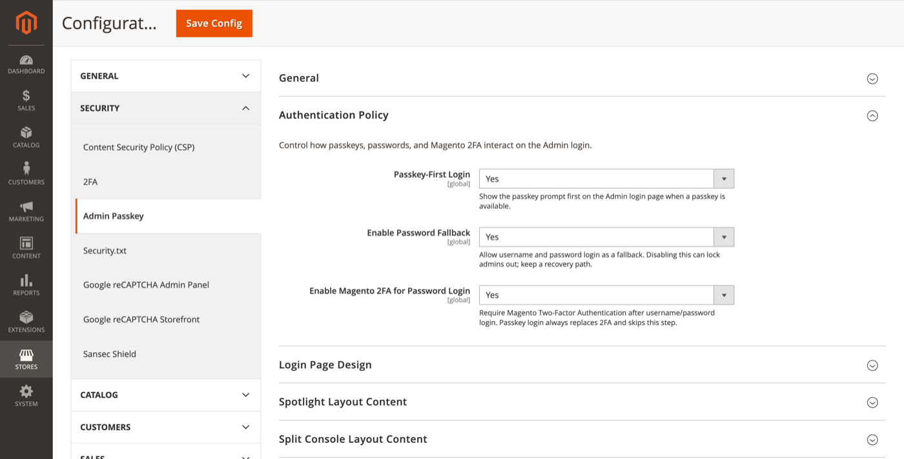

# Authentication Policy

Control how passkeys, passwords, and Magento 2FA interact on Admin login.

**Path:** Stores → Configuration → Security → Admin Passkey → **Authentication Policy**

## Settings

### Passkey-first login

When **Yes**, the Admin login page shows the passkey prompt first when a passkey is available for the browser (discoverable credential flow). Admins can still switch to the password tab.

### Enable password fallback

When **Yes**, username and password login remains available as a fallback.

When **No**, password login is rejected on the server (not only hidden on the
login page): a direct POST to the native Admin login fails with
"Password login is disabled". Password login is allowed again while
[emergency recovery mode](recovery.md) is active.

> Disabling password fallback can lock admins out if all passkeys are lost. Always keep [Recovery](recovery.md) enabled or maintain a break-glass procedure before turning this off.

### Enable Magento 2FA for password login

When **Yes**, Magento Two-Factor Authentication is required after a successful username/password login.

**Important:** A passkey only replaces Magento 2FA when the authenticator performed
*user verification* (PIN, fingerprint, face). Such a passkey is two factors in one
(possession + knowledge/biometrics). A security key without PIN or biometrics only
proves possession; after such a login Magento 2FA still follows. Set
[User Verification](webauthn.md) to **Required** to reject those authenticators
altogether.

## Login flow summary

| Method | Username | Password | Magento 2FA |
|--------|----------|----------|-------------|
| Passkey with user verification | Not required | Not required | Skipped |
| Passkey without user verification | Not required | Not required | Required (if Magento 2FA is enabled) |
| Password fallback | Required | Required | Required (if enabled) |

Passkey login applies the same account checks as a password login: inactive,
role-less, Magento-locked (`lock_expires`) and expired (Magento_Security) admins
are rejected, the login is recorded and a Magento_Security admin session is
registered (including "terminate other sessions" when account sharing is off).

## Related topics

- [Admin login](admin-login.md) — what admins see on the login page
- [WebAuthn](webauthn.md) — discoverable passkey settings (`Resident Key`)
