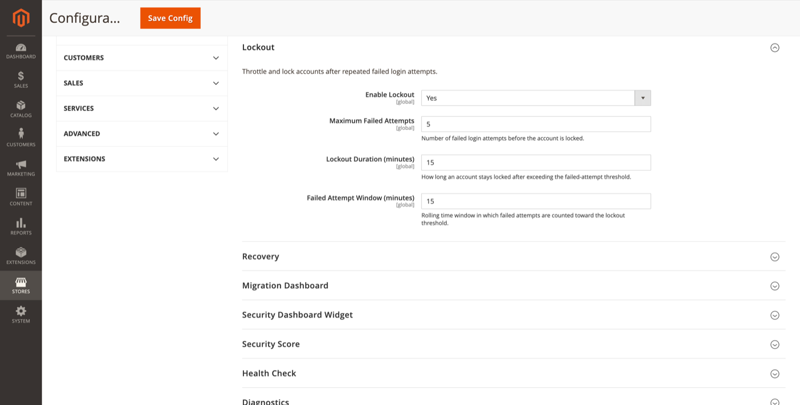

# Lockout

Throttle and lock administrator accounts after repeated failed login attempts.

**Path:** Stores → Configuration → Security → Admin Passkey → **Lockout**



## Settings

| Field | Default | Description |
|-------|---------|-------------|
| Enable Lockout | Yes | Enable brute-force throttling. |
| Maximum Failed Attempts | 5 | Failed attempts before the account is locked. |
| Lockout Duration (minutes) | 15 | How long the account stays locked after exceeding the threshold. |
| Failed Attempt Window (minutes) | 15 | Rolling window in which failed attempts count toward the threshold. |

## How lockouts are tracked

Failed attempts are counted per admin account, per username and per IP address.
A lockout lasts until it expires, an admin unlocks it, or [recovery mode](recovery.md)
is activated. Password login is blocked by account, username and IP lockouts.
Passkey login is blocked by IP lockouts and by lockouts of the account itself
(for example after wrong passwords in the passkey registration step-up), but not
by a username lockout, so a passkey stays a way in when someone floods a username.

Each dimension has its own counter row, so one failed attempt can show up as
separate rows (account, username, IP) in the Lockouts grid. Unlocking a username
row does not unlock the IP row, and vice versa.

A successful login only releases the rows of the account that signed in (its
admin id and username). It never releases an IP row, so an attacker cannot clear
an IP lockout by signing in with an account of their own.

### Trade-off: username lockouts

Because failures are also counted per username, anyone who can reach the Admin
login page can lock the password path of any admin account by guessing wrong
passwords for that username (a targeted denial of service). This is a deliberate
trade-off against online password guessing. Mitigations:

- Restrict access to the Admin URL (IP allowlist, VPN, custom Admin path).
- Register passkeys for every admin; the locked account can still be released
  by another admin, by `bin/magento adminpasskey:lockouts:unlock` or via recovery mode.
- Keep the lockout duration short.

## Admin UI

**Reports → Admin Passkey → Lockouts** shows currently locked accounts.

ACL: `FalconMedia_AdminPasskey::lockouts`

From this grid you can review lockout reason, timestamp, and unlock accounts manually.

## CLI

```bash
# List locked accounts
bin/magento adminpasskey:lockouts:list

# Unlock by username or ID
bin/magento adminpasskey:lockouts:unlock --username=admin
```

See [CLI commands](cli-commands.md).

## Notifications

When an account is locked, the [Lockout notification template](email-templates.md) can email the administrator (if configured).

## Fail2Ban

Failed login events are also written to the Fail2Ban-compatible log when enabled. See [Fail2Ban](fail2ban.md).

## Related topics

- [Security dashboard widget](security-dashboard-widget.md) — Active Lockouts and Failed Logins cards
- [Recovery](recovery.md) — emergency access when locked out entirely
